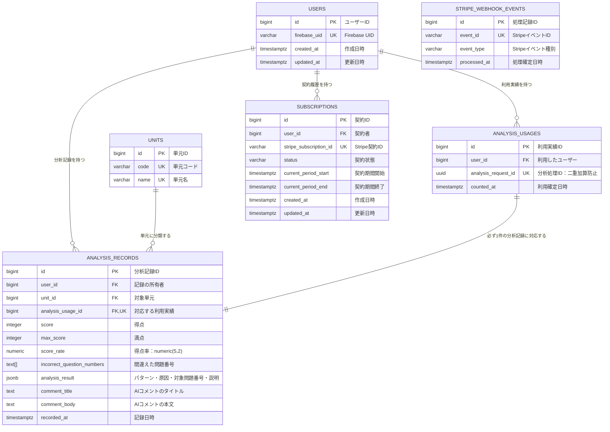

# DB 設計

本書は、PRD Ver.1.37およびチームでの決定事項をもとにしたMVP向けのDB設計とする。課金関連の未確定事項と、技術上の設計案は明記する。

（2026/10/04更新：Issue #10の決定事項を反映）
共通テーブルである`users`・`units`・`analysis_records`を先行して確定する。`analysis_records.analysis_usage_id`から`analysis_usages.id`への紐づけ、および本書に記載した検索用インデックスは今回の確定範囲とする。`analysis_records`が`analysis_usages`を参照するため、モデル・マイグレーション作成時は、参照先の`analysis_usages`も合わせて用意する。利用実績の保存・加算タイミングと契約状態の判定は、本書にIssue #10の決定事項を反映する。未決定の課金API詳細等は別途確定する。

（2026/10/25更新：Issue #23の月間上限と、マージ済み[PR #145](https://github.com/ms-engineer-bc26-05/Section9_team-a/pull/145)の契約・Webhook処理記録を反映）
`subscriptions`・`stripe_webhook_events`はPR #145のモデルとマイグレーション`0002_payment_tables.py`に合わせる。本書の更新ではDBマイグレーションは実行しない。

（2026/10/28更新：マージ済みPR #147の現在契約の選択・最新状態の再確認・終了済み状態の保護と、PR #153の利用上限確認を反映）

## 1. 設計方針

### 基本方針

| 項目               | 方針                                                                                                                                                   |
| ------------------ | ------------------------------------------------------------------------------------------------------------------------------------------------------ |
| DBMS               | PostgreSQL                                                                                                                                             |
| ORM                | SQLModel                                                                                                                                               |
| MVP対象            | 小学3年生の算数。学年・教科は固定のためDBに保持しない                                                                                                  |
| 子どもの管理       | 1アカウントにつき子ども1人。子どもテーブルは設けない                                                                                                   |
| 認証               | Firebase Authenticationを利用し、アプリDBにはFirebase UIDを保存する。新規登録・ログイン・ログアウトのみ。パスワード再設定・メール認証・退会はMVP対象外 |
| 認証情報           | メールアドレス・パスワードはFirebase側で管理し、今回のアプリDBには保存しない                                                                           |
| 分析記録           | 対象単元のStage Bが正常に返ったサーバー側の時点でBEが保存する                                                                                                   |
| 履歴表示           | 記録日時・単元・得点/満点の一覧をホーム画面にのみ表示する。履歴詳細はPhase2                                                                            |
| 利用実績           | 対象単元のStage B正常完了時にBEが1回記録する。利用実績と分析記録は同一トランザクションで保存する。対象外・判定困難・分析失敗の場合は、どちらも保存しない        |
| キャッシュ         | Memcachedは短時間のレート制限に使用する。正式な利用実績はPostgreSQLに保存する                                                                          |
| 契約情報           | Stripeのサブスクリプションのイベントで契約状態を更新し、statusがactiveであることを確認して月額プランを判定する                                                                                      |
| 月間利用回数の集計 | 日本時間（Asia/Tokyo）の暦月を基準とする。日時の保存・API表現はUTCを維持する                                                                           |

### 命名規則・型

以下は設計案とする。

- テーブル名は英語の複数形・`snake_case`とする。
- カラム名は英語の`snake_case`とする。
- 主キーは原則として自動採番の`bigint`とする。
- 外部キーは`user_id`、`unit_id`等、参照先が分かる名称とする。
- 日時は`timestamptz`を使用し、保存・APIでの日時表現はUTC、画面表示は日本時間とする。月間利用回数の集計期間はJSTの暦月とする。
- `updated_at`は更新処理時にアプリ側で設定する。デフォルトの`now()`は登録時に適用される。

### 削除方針

- MVPではユーザーによる履歴削除・アカウント削除機能を実装範囲に含めない。
- 現時点では論理削除用のカラムを設けない。
- 運用上の削除は物理削除を基本案とし、保存期間・削除手順は別途決定する。
- 関連データがあるユーザー・単元は、外部キー制約で削除を制限する。
- 一時画像・抽出データの削除は、永続データとは別に管理する。

### マイグレーション運用方針

以下を運用案とする。

- Alembicを利用し、マイグレーションファイルをリポジトリで管理する。
- DB構造の変更時は、モデル・マイグレーション・本設計書を合わせて更新する。
- 共有環境には、レビュー済みのマイグレーションを適用する。
- 共有・適用済みの変更は、原則として新しいマイグレーションで修正する。
- モデルは全て`db/models/`に配置する。

## 2. ER 図



- `analysis_records`は必ず1人のユーザーと1つの単元に紐づく。
- 利用実績1件と分析記録1件は、同一トランザクションでセットとして作成する。
- ER図の両者の1対1関係は業務上のルールを表す。利用実績だけを残さないことは、BEの保存処理で保証する。
- `analysis_usages`と`subscriptions`には直接の外部キーを設けず、`user_id`を通じて利用状況・契約状態を確認する。
- `stripe_webhook_events`はイベント単位の重複処理防止に使い、ユーザー・契約への外部キーは設けない。

## 3. テーブル定義

デフォルト欄の「—」はデフォルト値なしを表す。文字数上限・ID方式などの技術的な値は設計案とする。

### users

アプリ内のユーザーを管理する。

| カラム名     | 型           | NULL | デフォルト           | 説明                           |
| ------------ | ------------ | ---- | -------------------- | ------------------------------ |
| id           | bigint       | NO   | 自動採番（IDENTITY） | 主キー                         |
| firebase_uid | varchar(128) | NO   | —                    | Firebaseのユーザー識別子。一意 |
| created_at   | timestamptz  | NO   | now()                | 作成日時                       |
| updated_at   | timestamptz  | NO   | now()                | 更新日時                       |

### units

MVPで対応する単元を管理する。AI出力との対応には固定の単元コードを使用し、画面表示には単元名を使用する。

| カラム名 | 型           | NULL | デフォルト           | 説明                                     |
| -------- | ------------ | ---- | -------------------- | ---------------------------------------- |
| id       | bigint       | NO   | 自動採番（IDENTITY） | 主キー                                   |
| code     | varchar(50)  | NO   | —                    | AI出力との対応に使用する固定コード。一意 |
| name     | varchar(100) | NO   | —                    | 画面表示用の単元名。一意                 |

初期データ：

| code                           | name                 | 対象範囲                                 |
| ------------------------------ | -------------------- | ---------------------------------------- |
| `division`                     | わり算               | あまりのあるわり算を含む                 |
| `addition_subtraction_written` | たし算とひき算の筆算 | たし算・ひき算の筆算を同じ単元として扱う |

#### AI出力の名寄せ方法

- AIには、指定された単元コードと判定状態を返させる。
- 画像から単元名を取得できた場合はその情報を使用し、取得できない場合は問題内容から推定する。
- 「わり算」「割り算」「あまりのあるわり算」等はdivisionに分類する。
- 「たし算の筆算」「ひき算の筆算」等はaddition_subtraction_writtenに分類する。
- 「筆算」という表記だけでは分類せず、かけ算の筆算等を対象単元に含めない。
- Backendは受け取ったコードをunits.codeと照合し、対応するidをanalysis_records.unit_idに保存する。
- AI出力から単元マスタを自動追加しない。
- 想定外のコードや、判定状態とコードの不整合は出力形式エラーとして扱い、そのまま保存しない。

AI・Backend間の判定情報：

| unit_status    | 意味                    | unit_code          |
| -------------- | ----------------------- | ------------------ |
| `supported`    | MVP対象単元と特定できた | 対応する単元コード |
| `unsupported`  | MVP対象外と判断できた   | `null`             |
| `undetermined` | 単元を判断できなかった  | `null`             |

判定情報はAPIで受け渡すための項目とし、今回のDBには専用カラムを追加しない。対象外・判定困難時の保存・利用回数は、第5章のルールに従う。

### analysis_records

正常完了し、対象単元を特定できた分析記録を保存する。

| カラム名                   | 型           | NULL | デフォルト           | 説明                                                     |
| -------------------------- | ------------ | ---- | -------------------- | -------------------------------------------------------- |
| id                         | bigint       | NO   | 自動採番（IDENTITY） | 主キー                                                   |
| user_id                    | bigint       | NO   | —                    | `users.id`への外部キー                                   |
| unit_id                    | bigint       | NO   | —                    | `units.id`への外部キー                                   |
| analysis_usage_id          | bigint       | NO   | —                    | `analysis_usages.id`への外部キー。一意。対応する利用実績 |
| score                      | integer      | NO   | —                    | 保護者が入力した得点。整数のみ。                         |
| max_score                  | integer      | NO   | —                    | 保護者が入力した満点。整数のみ。                         |
| score_rate                 | numeric(5,2) | NO   | —                    | BEで算出した得点率。                                     |
| incorrect_question_numbers | text[]       | NO   | `'{}'::text[]`       | 間違えた問題番号の一覧                                   |
| analysis_result            | jsonb        | NO   | —                    | 構造化した分析結果                                       |
| comment_title              | text         | NO   | —                    | AIコメントのタイトル                                     |
| comment_body               | text         | NO   | —                    | AIコメントの本文                                         |
| recorded_at                | timestamptz  | NO   | now()                | 記録日時                                                 |

`analysis_result`には、間違え方のパターン・原因の種類・対象問題番号・分析の説明を保存する。AIレスポンス全文や、問題文・解答・計算過程等の元データを丸ごと保存しない。JSONの項目・形式は担当と合意する。`incorrect_question_numbers`を、保護者による確認済みの正誤に基づく誤答一覧の正とする。BEは、`analysis_result`内の各分析の対象問題番号が、この一覧に含まれることを検証する。原因を分析できない誤答もあるため、両者の完全一致は要求しない。

間違えた問題番号の例：

```text
["1:1(2)", "1:2(1)", "2:3"]
```

- 大問・小問を扱えるよう、番号は文字列として保存する。
- 全問正解の場合は空配列とする。
- 空配列を「読み取りに失敗した」という意味で使用しない。
- 保存用の問題番号は「画像番号:用紙上の問題番号」とする。画像が1枚の場合も`1:`を付ける。
- 問題番号が不明な場合は、`1:番号不明-q3`のような仮識別子を使用する。
- 同一画像内で番号が重複する場合は、`question_id`を付けて区別する。
- `analysis_result`内の対象問題番号にも、同じ保存用表記を使用する。
- 保存した問題番号を表示する履歴詳細画面は、MVPでは実装しない。

### analysis_usages

対象単元のStage Bが正常に返ったサーバー側の時点で、BEが正式な利用実績を分析1回につき1件保存する。FEの表示完了通知・画面への到達を加算条件にしない。

| カラム名            | 型          | NULL | デフォルト           | 説明                                     |
| ------------------- | ----------- | ---- | -------------------- | ---------------------------------------- |
| id                  | bigint      | NO   | 自動採番（IDENTITY） | 主キー                                   |
| user_id             | bigint      | NO   | —                    | 利用したユーザー。`users.id`への外部キー |
| analysis_request_id | uuid        | NO   | —                    | Backendで発行する分析処理ID。一意        |
| counted_at          | timestamptz | NO   | now()                | BEで利用回数として確定したUTC日時               |

- 同一分析の再送・結果再取得では、同じ分析処理IDを使用し、再保存・再加算しない。
- 表裏2画像を分析した場合も、1回として記録する。
- 対象外・判定困難・分析失敗の場合は、利用実績を記録しない。
- 分析記録は必ず1件の利用実績に紐づき、利用実績1件には必ず1件の分析記録を対応させる。
- 利用実績と分析記録は、同一トランザクションで保存する。
- 月間利用回数は、JSTの暦月に対応する期間の利用実績件数から集計する。詳細は第5章に記載する。
- Memcachedの情報を正式な利用回数として扱わない。

### subscriptions

月額300円の単一プランの契約を管理する。プランの種類を識別するカラムは設けない。Stripeのサブスクリプションのイベントを受け、最新の契約状態を取得して保存する（PR #145）。

| カラム名               | 型           | NULL | デフォルト           | 説明                                     |
| ---------------------- | ------------ | ---- | -------------------- | ---------------------------------------- |
| id                     | bigint       | NO   | 自動採番（IDENTITY） | 主キー                                   |
| user_id                | bigint       | NO   | —                    | 契約者。`users.id`への外部キー           |
| stripe_subscription_id | varchar(255) | NO   | —                    | Stripe契約ID。一意                       |
| status                 | varchar(50)  | NO   | —                    | Stripeサブスクリプションの状態。activeを確認して月額プランを判定 |
| current_period_start   | timestamptz  | YES  | —                    | 現在の契約期間の開始日時。未確定時はNULL |
| current_period_end     | timestamptz  | YES  | —                    | 現在の契約期間の終了日時。未確定時はNULL |
| created_at             | timestamptz  | NO   | now()                | 作成日時                                 |
| updated_at             | timestamptz  | NO   | now()                | 更新日時                                 |

同じStripe契約の更新時は既存行を更新する。再加入等で新しい契約が作成された場合は別の行を登録する。

このテーブルは契約単位の情報を持つものであり、すべての状態変更履歴を保存するものではない。

現在の契約を画面へ返す場合は`active`を優先し、同じ優先度では`created_at`降順・`id`降順で選ぶ。`active`がなければいちばん新しい契約を返す（PR #147）。

契約状態・有効期間を保存する。BEは`status`が`active`の場合のみ有効な月額プランと判定する。契約状態と月間利用回数を合わせた分析可否は、API設計書の`GET /v1/usage`に従う。契約期間はStripeの先頭の明細（`items.data[0]`）から取得する。

### stripe_webhook_events

処理済みのStripeイベントを記録し、同じ通知の再送による二重処理を防ぐ（PR #145）。イベント本文・署名・顧客情報は保存せず、次の項目のみ保持する。

| カラム名 | 型 | NULL | デフォルト | 説明 |
| --- | --- | --- | --- | --- |
| id | bigint | NO | 自動採番（IDENTITY） | 主キー |
| event_id | varchar(255) | NO | — | StripeイベントID。一意 |
| event_type | varchar(255) | NO | — | Stripeイベント種別 |
| processed_at | timestamptz | NO | now() | 処理記録の作成日時 |

- 対象の契約イベントについて、処理記録と契約の追加・更新を同一トランザクションで保存する。
- アプリの`metadata.user_id`を取得できない契約は更新せず、イベントの処理記録だけを保存する。
- 対象外イベントや、最新の契約状態を取得できず失敗したイベントは記録しない。

## 4. インデックス・制約

### 主キー・ユニーク制約

| テーブル         | カラム                 | 制約        |
| ---------------- | ---------------------- | ----------- |
| 全テーブル       | id                     | PRIMARY KEY |
| users            | firebase_uid           | UNIQUE      |
| units            | code                   | UNIQUE      |
| units            | name                   | UNIQUE      |
| analysis_records | analysis_usage_id      | UNIQUE      |
| analysis_usages  | analysis_request_id    | UNIQUE      |
| subscriptions    | stripe_subscription_id | UNIQUE      |
| stripe_webhook_events | event_id | UNIQUE |

### 外部キー

| テーブル         | カラム            | 参照先             | 削除時の方針案 |
| ---------------- | ----------------- | ------------------ | -------------- |
| analysis_records | user_id           | users.id           | RESTRICT       |
| analysis_records | unit_id           | units.id           | RESTRICT       |
| analysis_records | analysis_usage_id | analysis_usages.id | RESTRICT       |
| analysis_usages  | user_id           | users.id           | RESTRICT       |
| subscriptions    | user_id           | users.id           | RESTRICT       |

### CHECK制約

| テーブル         | 制約                                                                       |
| ---------------- | -------------------------------------------------------------------------- |
| analysis_records | `score_rate >= 0 AND score_rate <= 100`                                    |
| analysis_records | `max_score > 0`                                                            |
| analysis_records | `score >= 0 AND score <= max_score`                                        |
| subscriptions    | 開始・終了日時が両方設定されている場合、終了日時が開始日時より後であること |

### 検索用インデックス

主キー・ユニーク制約は、検索性能とは別に、データの識別・重複防止のため設定する。

| テーブル         | 対象カラム               | 用途                             |
| ---------------- | ------------------------ | -------------------------------- |
| analysis_records | `(user_id, recorded_at)` | ユーザー別の履歴取得             |
| analysis_records | `(user_id, unit_id)`     | ユーザー・単元別のランキング集計 |
| analysis_usages  | `(user_id, counted_at)`  | ユーザー別の月間利用回数集計     |

## 5. データ保持・整合性ルール

### 保存対象

| データ                                                                     | 方針                     |
| -------------------------------------------------------------------------- | ------------------------ |
| ユーザー識別情報                                                           | `users`に保存            |
| 単元マスタ                                                                 | `units`に保存            |
| 得点・満点・得点率・単元・間違えた問題番号・記録日時・分析結果・AIコメント | `analysis_records`に保存 |
| 利用実績                                                                   | `analysis_usages`に保存  |
| 契約情報                                                                   | `subscriptions`に保存    |
| 処理済みStripeイベントの識別子・種別・処理日時 | `stripe_webhook_events`に保存 |

### 永続保存しない情報

- テスト画像・問題画像・答案画像
- OCR全文テキスト
- 確認済み解答・計算過程

分析結果・コメントは今回の結果画面で表示するために使用するが、過去の詳細表示はPhase2とする。

### 分析結果の状態別の扱い

| 状態                               | 分析記録   | 利用実績    |
| ---------------------------------- | ---------- | ----------- |
| 対象単元を特定でき、分析が正常完了 | 保存する   | 1回記録する |
| 単元を特定できず判定困難として終了 | 保存しない | 記録しない  |
| 対象外単元と判定して終了           | 保存しない | 記録しない  |
| 分析失敗・有効な分析結果なし       | 保存しない | 記録しない  |

対象単元のStage Bが正常に返ったサーバー側の時点で、BEが分析記録と利用実績を同一トランザクションで保存・確定する。保存・加算済みの結果が画面へ届かなかった場合も取り消さず、同じ分析処理IDで結果を再取得できるようにする。

### 月間利用回数の集計

- 無料枠の月間利用回数は、日本時間（Asia/Tokyo）の暦月で集計する。
- 集計範囲は、JSTの当月1日00:00:00以上、翌月1日00:00:00未満とする。
- 日時の保存・APIでの表現はUTCを維持する。
- BEはJSTの当月・翌月の月初をUTCへ変換し、対象ユーザーの`analysis_usages.counted_at`を範囲検索して件数を集計する。
- 月が変わった場合は集計対象期間を切り替える。利用実績を削除して回数をリセットする方式にはしない。
- 有料プランは月10回まで（無料の2回を含む）。当月の上限に達した場合は契約の有無にかかわらず分析不可とする（Issue #23）。上限の値は設定で管理し、DBに新しい集計用カラムは追加しない。

### 得点・満点・得点率の計算・保存・表示

1. フロントから得点・満点をBackendへ送信する。
2. Backendで、得点・満点が整数であり、満点が0より大きく、得点が0以上かつ満点以下であることを検証する。
3. `得点 ÷ 満点 × 100`で得点率を計算する。
4. 得点・満点と、計算した得点率を同時に保存する。
5. 得点率は小数第3位を四捨五入し、`numeric(5,2)`で保存する。
6. 学習履歴には得点・満点を表示する。例：`80点／100点`。
7. ランキングには保存済み得点率を使用し、従来の平均・丸め・同順位のルールを適用する。（本章『苦手単元ランキング』参照）

得点率はBackendで計算し、フロントから送られた計算値をそのまま保存しない。
将来、得点・満点の編集に対応する場合は、得点率も再計算して同時に更新する。

### 苦手単元ランキング

- 対象ユーザーの**全期間**の保存済み分析記録を集計する。
- 年度・期間による絞り込みは行わない。
- 同一単元の保存済み得点率の平均を算出する。
- 平均を算出した後、小数第2位を四捨五入して小数第1位に揃える。
- 丸めた値が低い順に順位を付ける。
- 同じ値は同順位とし、次の順位は**「1位・1位・3位」方式**とする。
- 同順位内の表示順は`units.code`順とする。
- 記録のない単元には順位を付けない。

例：

| 丸める前の平均得点率 | 順位判定に使う値 | 順位 |
| -------------------- | ---------------- | ---- |
| 70.04％              | 70.0％           | 1位  |
| 70.03％              | 70.0％           | 1位  |
| 83.33％              | 83.3％           | 3位  |

### 二重保存・二重加算の防止

- Backendで分析処理IDと所有者を確認する。
- 同じ`analysis_request_id`は1回だけ利用確定できる。
- 利用実績1件と分析記録1件は、必ず同一トランザクションで作成する。
- 作成した利用実績のIDを`analysis_records.analysis_usage_id`に設定する。
- BEは両レコードの`user_id`が一致することを検証する。
- 片方の保存に失敗した場合は両方をロールバックし、利用実績だけを残さない。
- 同じ分析処理IDの再送・再取得では、確定済みの結果を使用し、利用実績・分析記録を再登録しない。
- BEは認証済みユーザーと所有者を照合し、`analysis_usages.analysis_request_id`と`user_id`から利用実績を確認して、`analysis_records.analysis_usage_id`に対応する保存済み結果を取得する。一時データの期限切れによって保存済み結果の再取得を拒否しない。
- UNIQUE制約とBEの保存処理により、同時実行時も二重保存・二重加算を防ぐ。
- 無料枠・月間上限はPR #153で実装済み。保存時はユーザーごとのロック取得後に保存済みIDを再確認し、利用回数を数え直す。分析の同時実行そのものを止める仕組みとは区別する。

### 一時データ・永続データの削除

- 画像は確認・修正と必要な分析が終わった後に削除する。
- 分析失敗時は画像を直ちに削除する。
- 障害等で即時削除できない場合に備え、一時データを一定時間後に自動削除する仕組みを設ける。保持期限はIssue#27で決定する。
- 途中離脱時の一時データの扱い・具体的な削除方式はインフラ設計で確定する。
- 永続データの保存期間・運用上の削除手順は別途決定する。

### 契約情報

- 署名検証済みの`customer.subscription.created`・`customer.subscription.updated`・`customer.subscription.deleted`を処理する。請求書イベントでは契約を更新しない。
- 契約とユーザーはStripe契約の`metadata.user_id`で紐づける。取得できない場合は警告を記録し、契約を保存せずイベントの処理記録のみ保存する。
- 同じStripe契約IDは既存行を更新し、既存の`user_id`は上書きしない。新しい契約IDで再加入した場合は別の行を作成する。
- DBで`canceled`・`incomplete_expired`になっている行は、UPSERTの更新条件で除外し、古い`active`等で上書きしない。終了前の状態同士の競合による順序のずれはMVPでは許容する（PR #147）。
- `stripe_webhook_events.event_id`のUNIQUE制約により、同じ通知を二重に処理しない。
- 同じ契約の異なる通知が同時に届いた場合は、契約IDをキーに`pg_advisory_xact_lock(hashtext(stripe_subscription_id))`でトランザクション単位のロックを取り、最新状態の取得から保存までを直列化する。新規契約で行がまだない場合も適用する。
- ロック取得後にStripeから最新状態を取得する。イベント本文の状態をそのまま保存して、解約済み状態等を古い状態で上書きしない。
- イベントの処理記録と契約の追加・更新は同一トランザクションとする。コミット・ロールバックでロックを解放する。最新状態の取得に失敗した場合はロールバックし、再送で処理できる状態にする。
- Checkout作成時とWebhookでの重複契約判定時は、ユーザーごとのロックを取り、DBで`active`となっている本人の契約をStripeでも再確認する。Stripe上で`active`でなければDBを最新状態へ更新し、通知遅延・欠落による誤った契約拒否・自動解約を避ける。確認に失敗した場合はロールバックする（PR #147）。
- 同じ人の別契約がStripe上でも`active`の場合、Webhook処理中の重複契約を自動解約してその状態を保存する。テストモードでは返金処理を含まない。APIの応答・再送時の扱いはAPI設計書第3.10節に従う。
- 月額プランの判定は`subscriptions.status`が`active`の場合のみとする。請求書の支払状態と契約状態は区別する。画面への返却形式・利用可否の優先順位はAPI設計書を参照する。

### 未確定事項

| 項目       | 確認・決定する内容                                                         |
| ---------- | -------------------------------------------------------------------------- |
| AI連携     | 第3章で定義した単元コード・判定状態をAPI仕様書に反映する                   |
| 有料プラン | 通常の解約操作・画面連携の詳細は別途確認する。Checkout・重複契約対策・現在契約の選択はPR #147で確定済み |
| 運用       | 永続データの保存期間・削除手順                                             |

PRD・機能要件・DB設計Issueの保存項目も、「ユーザーに紐づけた単元・得点・満点・得点率・間違えた問題番号・記録日時・分析結果・AIコメント」に統一する。
