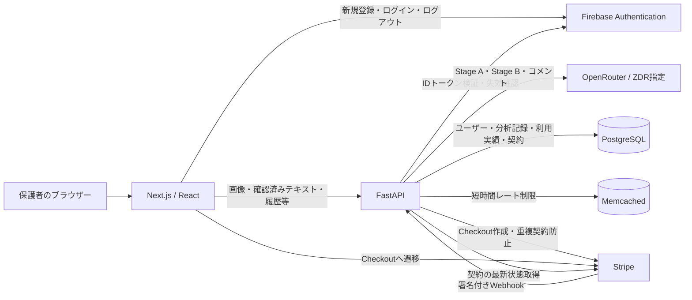

# アーキテクチャ設計

## 全体構成

実線は呼び出しの実装あり。実環境での疎通を保証する図ではない。

## 配置・責務

| 構成       | 現在の実装・責務                                                                                                                  | 根拠（リポジトリルートからのパス）                                         |
| ---------- | --------------------------------------------------------------------------------------------------------------------------------- | -------------------------------------------------------------------------- |
| Frontend   | PCで別途起動。Firebase認証・IDトークン付きAPI通信、画像選択・任意トリミング・保護者確認・結果表示。利用状況取得、Checkout開始、契約状態の確認を行う | `frontend/lib/api/`、`frontend/lib/firebase/auth.ts`、`frontend/features/` |
| Backend    | 認証・入力検証・AI呼び出し・保存・月間利用可否判定・Checkout作成を機能単位に分離                                                  | `backend/app/features/`                                                    |
| AI         | 画像から事実を抽出し、確認済みテキストを分析。生レスポンスをschemaで検証                                                          | `backend/app/features/ai_analysis/`                                        |
| PostgreSQL | SQLModel経由で永続化。DBモデルは`app/db/models/`に集約                                                                            | `backend/app/db/`                                                          |
| Memcached  | Stage A／Stage Bを別々に、1ユーザー1分3回まで制限。接続不可時は警告を出して分析を継続                                             | `backend/app/features/usage/service.py`、`cache.py`                        |
| Stripe     | Checkout作成・重複契約防止・現在の契約取得、Webhook署名検証・重複排除・契約同期を実装                                             | `backend/app/features/payment/`                                            |

ComposeはBackend・DB・Memcachedを起動する。Backendのみ`127.0.0.1:8000`へ公開し、DB・MemcachedのポートはPCへ公開しない。DBは名前付きvolume、Firebase鍵は読み取り専用マウント。AWS・Nginx・冗長構成は本リポジトリで構築済みとは扱わない。

## 分析と保存の境界

1. Frontendから最大2画像をStage Aへ送る。Backendで容量・形式・破損を検証し、画像を永続保存せず読み取る。
2. Stage Aの結果をFrontendに返し、保護者が読み取り内容を確認・修正し、得点と満点を入力する。
3. Stage Bには確認済みテキストのみを送る。単元判定、必要な間違え方分析、コメント生成を行う。
4. 対象単元の分析完了時だけ、利用実績と分析記録を同一DBトランザクションで保存する。対象外・単元判定困難では両方保存しない。

Stage A・Stage Bの開始前に月間利用可否とレート制限を確認する。無料は月2回、有料は無料分を含め月10回（`MONTHLY_ANALYSIS_LIMIT`の既定値）。利用回数は日本時間の暦月で数え、Stage Bの保存直前にもユーザー単位のDBロックを取得して上限を再確認する。

分析IDはStage Aで発行するが、その所有者・有効期限は未検証。保存済みIDは409となり、結果の再取得やIdempotency-Keyによる冪等応答は未実装。FrontendはBackendの利用状況・Checkout作成・現在契約APIと接続し、成功URLへ戻った後もWebhookで同期された有効な契約を確認してから成功表示にする。

シーケンス図は作成しない（[GitHub運用書 §11](GitHub運用書.md#11-mustドキュメントの方針決定事項)）。分析・決済の処理順序は[技術選定](技術選定.md#5-処理フローissue-11)を参照。

## 関連資料

- [ログ設計](ログ設計.md)・[セキュリティ設計](セキュリティ設計.md)
- [テスト設計書](テスト設計書.md)・[運用・性能・可用性設計](運用・性能・可用性設計.md)
- [API設計](API設計.md)・[DB設計](DB設計.md)・[Backendコーディング規約](<バックエンド_コーディング規約 v2.md>)・[Frontendコーディング規約](フロントエンドコーディング規約.md)
